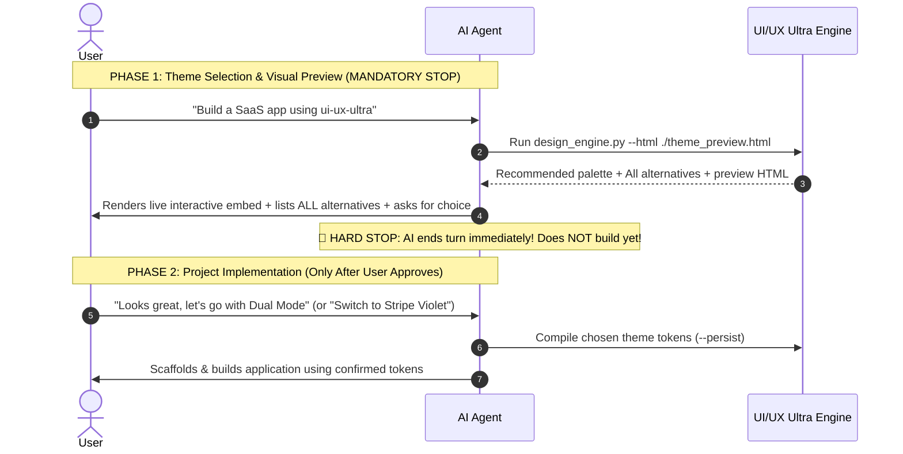

# UI/UX Ultra v1.0.0 — Design Intelligence & Multi-Platform Theme Compiler

> **Created by Pardeep Kumar** | **Powered by [ToolNPlay.com](https://ToolNPlay.com)**  
> **GitHub**: [https://github.com/PardeepPatel/ui-ux-ultra](https://github.com/PardeepPatel/ui-ux-ultra)

A comprehensive design intelligence engine featuring **200 curated, dual-theme palettes** across 20 distinct industry domains. Every palette is engineered with mathematically balanced surface contrast, dedicated Light & Dark polarities, typography pairings, UX Laws enforcement, and native code generation for **Web (Tailwind/Shadcn)**, **Flutter**, and **SwiftUI**.

---

## 1. The Core USP: Mandatory Two-Phase Workflow (HARD STOP RULE)

UI/UX Ultra's main USP is that **it gives the user full visual control over their brand identity before any application code is written**.

To protect this USP, AI agents **MUST ALWAYS follow this strict TWO-PHASE protocol**:



---

### 🛑 PHASE 1: Preview & Theme Selection Protocol (CURRENT TURN)

When the user asks to build, create, or design any website, dashboard, or app:

#### Step 1: Detect Domain & Run Synthesis Engine
Extract the domain category (e.g. `saas`, `travel`, `healthcare`, `fintech-crypto`, etc.) and run the design engine to generate the interactive preview HTML:

```bash
# Locate design_engine.py in ~/.gemini/config/skills/ui-ux-ultra/scripts/ (or workspace)
python3 ~/.gemini/config/skills/ui-ux-ultra/scripts/design_engine.py "<keywords>" --category <category> --html ./theme_preview.html
```

#### Step 2: Present the Interactive Embed & Alternatives in Chat
In your chat response, you **MUST**:
1. **Render the Live Interactive Embed**:
   ```html
   <agent-embed src="file:///absolute/path/to/theme_preview.html"></agent-embed>
   ```
2. **Detail the #1 Recommended Palette**: Display name, family ID, light/dark accent colors, and WCAG contrast rating.
3. **List ALL Available Alternatives in that Category**: Detail all 4-5 alternative families in that vertical with their family IDs, display names, accents, and specific vibes.
4. **Ask the User for Theme & Polarity Choice in Plain Markdown Text**:
   > **🌓 Theme & Polarity Selection:**
   > - **(Recommended) Support for Both (Dual Light & Dark with toggle)** — *Modern production standard with zero-flash toggle and system preference auto-detection.*
   > - **Dark Mode only** — *Sleek, high-focus obsidian aesthetic.*
   > - **Light Mode only** — *Crisp daylight clarity and high-contrast readability.*
   >
   > *Would you like to proceed with the recommended palette in **Dual Mode**, or switch to one of the alternatives above?*

#### ⛔ MANDATORY HARD STOP (DO NOT BUILD CODE YET!):
- **DO NOT** write application code (HTML, JSX, TSX, CSS).
- **DO NOT** scaffold the project or create repository files.
- **DO NOT** call the `ask_question` modal tool (which covers the chat with plain text buttons).
- **END YOUR TURN IMMEDIATELY** after outputting the preview embed and the questions above. Wait for the user's response!

---

### 🚀 PHASE 2: Code Implementation (NEXT TURN — AFTER USER REPLIES)

Only **after** the user replies to confirm their theme choice or select an alternative, proceed with building the project:

#### Step 3: Compile Design Tokens & Output Bundle
Run the synthesis engine with `--persist` targeting the user's confirmed palette:
```bash
python3 ~/.gemini/config/skills/ui-ux-ultra/scripts/design_engine.py --palette-id <confirmed-id> --persist -p "<Project Name>"
```

This compiles:
- `design-system/theme-tokens.css`: Standard CSS custom properties for light & dark modes
- `design-system/shadcn-globals.css`: Drop-in `globals.css` with HSL variables for shadcn/ui
- `design-system/tailwind-v4.css`: Modern Tailwind CSS v4 `@theme` configuration
- `design-system/tailwind.tokens.js`: Ready-to-import Tailwind CSS v3 color map
- `design-system/flutter_theme.dart`: Material 3 ThemeData with light & dark ColorSchemes
- `design-system/Theme.swift`: SwiftUI semantic Color extensions & iOS HIG constants
- `design-system/motion.tokens.js`: Framer Motion spring presets and easing curves
- `design-system/theme-toggle.js`: Zero-flash client-side theme switcher
- `design-system/MASTER.md`: Design system documentation and token reference

#### Step 4: Inject Semantic Design Tokens into the Project
Import `design-system/theme-tokens.css` into the project's main stylesheet. All UI elements must reference these semantic tokens rather than raw hardcoded hex codes:

```css
:root, [data-theme="light"] {
  --bg-canvas: #F8FAFC;        /* Base page background */
  --bg-surface: #FFFFFF;       /* Cards, modals, sidebars */
  --bg-elevated: #F1F5F9;      /* Dropdowns, hover states, chips, toggles */
  --text-primary: #0B0F19;     /* Headlines, body reading text, toggle text */
  --text-muted: #475569;       /* Secondary labels, hints, captions */
  --accent-primary: #4F46E5;   /* Primary CTAs, active highlights */
  --accent-foreground: #FFFFFF;/* Text/icon color ON top of accent background */
  --accent-secondary: #0D9488; /* Badges, secondary actions, metrics */
  --elevated-foreground: #0B0F19; /* High-contrast text on elevated cards & toggles */
  --border-color: #E2E8F0;     /* Dividers, card strokes */
}

[data-theme="dark"] {
  --bg-canvas: #08090C;
  --bg-surface: #11131A;
  --bg-elevated: #1A1D27;
  --text-primary: #F3F4F6;
  --text-muted: #8A94A6;
  --accent-primary: #6366F1;
  --accent-foreground: #FFFFFF;
  --accent-secondary: #14B8A6;
  --elevated-foreground: #F3F4F6;
  --border-color: #222634;
}
```

#### 🛡️ Dynamic Foreground-Background Contrast Rules (Zero Washed-Out Text)
1. **Container-Relative Inversion**:
   - In **Dark Mode**, elevated containers (cards, toggles, badges, chips) have dark backgrounds (`#1A1D27` or `rgba(255,255,255,0.08)`) with light foreground text (`#F3F4F6`).
   - In **Light Mode**, elevated containers flip to light backgrounds (`#F1F5F9` or `rgba(0,0,0,0.06)`). Their foreground text **MUST** flip to high-contrast dark text (`var(--text-primary)` or `var(--elevated-foreground)`, e.g. `#0B0F19` or `#241914`).
   - **CRITICAL ANTI-PATTERN**: Never hardcode light text utility classes (e.g. `text-white`, `text-gray-100`, `text-[#FAF5EE]`) onto toggle buttons, badges, secondary buttons, or form controls that flip in Light Mode. Always use `var(--elevated-foreground)` or `var(--text-primary)`.
2. **Primary Accent Contrast**:
   - Primary action buttons must always use `--accent-foreground` computed against the accent's luminance (e.g. `#FFFFFF` on dark indigo/slate, `#0B0F19` on high-luminance volt/lime/yellow).
3. **Interactive Toggle Buttons**:
   - Mode toggles (`🌓 Toggle Light/Dark`) must explicitly update their `color`, `background-color`, and `border-color` on switch, guaranteeing a minimum of **7:1 AAA contrast** in both states.

### Step 4: Configure Tech Stack (Tailwind / Next.js / CSS)

#### In Tailwind CSS (`tailwind.config.js`)
```javascript
module.exports = {
  darkMode: ['class', '[data-theme="dark"]'],
  theme: {
    extend: {
      colors: {
        canvas: 'var(--bg-canvas)',
        surface: 'var(--bg-surface)',
        elevated: 'var(--bg-elevated)',
        primary: 'var(--text-primary)',
        muted: 'var(--text-muted)',
        accent: {
          DEFAULT: 'var(--accent-primary)',
          foreground: 'var(--accent-foreground)',
          secondary: 'var(--accent-secondary)'
        },
        'elevated-foreground': 'var(--elevated-foreground)',
        border: 'var(--border-color)'
      },
      fontFamily: {
        display: ['var(--font-display)'],
        sans: ['var(--font-sans)'],
        mono: ['var(--font-mono)']
      },
      borderRadius: {
        card: 'var(--radius-card)'
      }
    }
  }
};
```

#### In Tailwind CSS v4 (`main.css`)
```css
@theme {
  --color-canvas: var(--bg-canvas);
  --color-surface: var(--bg-surface);
  --color-elevated: var(--bg-elevated);
  --color-primary: var(--text-primary);
  --color-muted: var(--text-muted);
  --color-accent: var(--accent-primary);
  --color-accent-foreground: var(--accent-foreground);
  --color-accent-secondary: var(--accent-secondary);
  --color-elevated-foreground: var(--elevated-foreground);
  --color-border: var(--border-color);
  --font-display: var(--font-display);
  --font-sans: var(--font-sans);
  --font-mono: var(--font-mono);
}
```

### Step 5: Apply Curated Font Pairings
Load Google Fonts matched to the domain personality:

| Archetype / Domain | Display Font | Sans / Interface Font | Monospace Font | Google Fonts Embed Link |
| :--- | :--- | :--- | :--- | :--- |
| **Tech, SaaS, AI** | Space Grotesk | Plus Jakarta Sans | JetBrains Mono | `family=JetBrains+Mono:wght@400;600&family=Plus+Jakarta+Sans:wght@400;600;700&family=Space+Grotesk:wght@600;700` |
| **Editorial, Luxury, Art** | Fraunces | Plus Jakarta Sans | JetBrains Mono | `family=Fraunces:opsz,wght@9..144,600;700&family=Plus+Jakarta+Sans:wght@400;500;600` |
| **Dev Tools, CLI, Web3** | JetBrains Mono | Inter | JetBrains Mono | `family=Inter:wght@400;500;600&family=JetBrains+Mono:wght@400;500;700` |
| **Modernist, Studio** | Syne | Plus Jakarta Sans | Space Mono | `family=Plus+Jakarta+Sans:wght@400;600&family=Syne:wght@600;700;800` |

### Step 6: Architectural UI Style Selection
Select the design style that amplifies the chosen palette:

1. **Bento Grid**: Modern modular cards with subtle borders (`1px solid var(--border-color)`), 14px-18px corner radius, and varied column spans (12-column grid: `col-span-8`, `col-span-4`, `col-span-6`).
2. **Glassmorphic Elevated**: Surfaces with `backdrop-filter: blur(16px)` and semi-transparent alpha borders `rgba(255,255,255,0.08)`.
3. **High-Density Dashboard**: Compact tables, pill badges (`--bg-elevated`), monospace metric indicators, and crisp dividers.
4. **Editorial Luxury**: Large serif headlines (`--font-display`), generous whitespace (padding: 4rem-6rem), and hairline dividers.
5. **Modern Cyberpunk / Neon**: Deep dark canvas (`#08090C`), high-saturation neon accents (`#00F5D4`, `#FF2A85`), glow drop-shadows `0 0 24px rgba(var(--accent-primary), 0.3)`.

### Step 7: Dual-Theme Switching Implementation
Add the zero-flash theme script in the document `<head>`:

```html
<script>
  (function() {
    const stored = localStorage.getItem('theme-preference');
    const theme = stored || (window.matchMedia('(prefers-color-scheme: dark)').matches ? 'dark' : 'light');
    document.documentElement.setAttribute('data-theme', theme);
  })();
</script>
```

Add a toggle button in the navbar:
```html
<button onclick="toggleTheme()" class="theme-btn" aria-label="Toggle Light/Dark Theme">
  🌓 Theme
</button>
```

---

## 2. Complete 20-Category Domain Architecture

UI/UX Ultra organizes **200 palettes** across **20 categories** (5 curated families each, in both Light and Dark polarities):

```
UI/UX Ultra (200 Palettes)
├── 01. saas             (5 Families: Linear, Stripe, Geist, Raycast, Attio)
├── 02. education        (5 Families: Oxford, Axiom, Kinetic, Bauhaus, Montessori)
├── 03. pet-services     (5 Families: Sunny Meadow, Nordic Vet, Cozy Whiskers, Woodland, Reef)
├── 04. ai-chatbot       (5 Families: Velvet Cosmos, Anthropic Warm, Synapse Cyan, Aurora, Terminal)
├── 05. e-commerce       (5 Families: Atelier Alabaster, Tokyo Street, Nordic Home, Bazaar, Sonic)
├── 06. fintech-crypto   (5 Families: Emerald Quant, Swiss Private, DeFi Plasma, Neobank Lime, Ledger)
├── 07. healthcare       (5 Families: Clinical Telehealth, Biopharma, Mindful Sanctuary, Pediatric, Dental)
├── 08. creative         (5 Families: Motion Amber, Hyper 3D, Risograph Press, Brutalist, Monotype)
├── 09. real-estate      (5 Families: Architectural Marble, PropTech, Alpine Timber, Metropolitan, Campus)
├── 10. gaming           (5 Families: Cyberpunk HUD, 8-Bit Arcade, Apex Esports, Fantasy Lore, Cozy Island)
├── 11. food-restaurant  (5 Families: Omakase Hinoki, Neo-Diner Flame, Sourdough Hearth, Taproom, Matcha)
├── 12. fitness          (5 Families: Crossfit High-Volt, Mindful Yoga, Velocity Run, Aqua Tri, Combat)
├── 13. travel           (5 Families: Bharat Grand Trunk, Himalayan Alpine, Kyoto Rail, Archipelago, Lounge)
├── 14. nft-web3         (5 Families: Hologram Vault, Solana UV, Ordinal Amber, Agora DAO, Spatial Prism)
├── 15. beauty-spa       (5 Families: Aesop Apothecary, Rosewater, Onsen Hinoki, Derma Peel, Kumkumadi)
├── 16. developer-tools  (5 Families: Teenage Chassis, Warp Obsidian, Supabase Emerald, Grafana, Monokai)
├── 17. entertainment    (5 Families: Mythic Agni, A24 Cinema Noir, 2.5D Manhwa, Symphony Brass, Hi-Fi Vinyl)
├── 18. legal            (5 Families: Lincoln Mahogany, Patent IP, Supreme Wax Seal, Civic Policy, Family Trust)
├── 19. events           (5 Families: Afterhours Arcade, Arena Festival, Royal Mandap, Tech Summit, Gala)
└── 20. other            (5 Families: Universal Bento, Warm Craft PKM, CAD Blueprint, Nordic Calm, Kinetic Mono)
```

### Curated Palette Catalog Quick Reference

| Category | Family ID | Primary Name | Vibes | Light Accent | Dark Accent |
| :--- | :--- | :--- | :--- | :--- | :--- |
| `saas` | `saas-linear-indigo` | Linear Obsidian & Indigo | Modern precision command-bar | `#4F46E5` | `#6366F1` |
| `saas` | `saas-stripe-violet` | Stripe Mesh & Royal Slate | Enterprise billing clean | `#635BFF` | `#7A73FF` |
| `saas` | `saas-vercel-geist` | Geist Monochrome & Signal | Minimalist stark edge | `#000000` | `#FFFFFF` |
| `ai-chatbot` | `ai-velvet-cosmos` | Velvet Cosmos & Neural Violet | LLM reasoning copilot | `#7C3AED` | `#8B5CF6` |
| `ai-chatbot` | `ai-anthropic-warm` | Humanist Parchment & Clay | Humanist research alignment | `#C86446` | `#E07A5F` |
| `ai-chatbot` | `ai-synapse-cyan` | Synapse Matrix & Bioluminescence | Autonomous voice AI | `#059669` | `#10B981` |
| `developer-tools`| `dev-teenage-chassis` | Field Aluminium & Intl Orange | Hardware synth calculator | `#FF4F00` | `#FF5E1A` |
| `developer-tools`| `dev-supabase-emerald`| Postgres Emerald & Carbon | Database backend docs | `#10B981` | `#34D399` |
| `fintech-crypto` | `fin-emerald-quant` | Emerald Quant & Institutional | Wall Street wealth terminal | `#059669` | `#10B981` |
| `fintech-crypto` | `fin-swiss-private` | Zurich Private Banking Gold | Heritage gold card wealth | `#9A7B3E` | `#D4AF37` |
| `e-commerce` | `ecom-atelier-alabaster`| Atelier Alabaster & Espresso | Luxury fashion apparel lookbook | `#8C4A27` | `#D48C6A` |
| `e-commerce` | `ecom-tokyo-street` | Shibuya Streetwear & Volt | Limited sneakers drops | `#FF2A00` | `#CCFF00` |
| `healthcare` | `health-telehealth-sky` | Nordic Telehealth & Pure Sky | HIPAA clinic calm trust | `#0284C7` | `#38BDF8` |
| `creative` | `creative-hyper-3d` | Hyper-Spatial Glass & Cyan | 3D visual generative | `#06B6D4` | `#00F5D4` |
| `gaming` | `game-cyber-neon` | Night City Cyberpunk HUD | Neon raytracing HUD | `#FF0055` | `#00F5D4` |
| `nft-web3` | `web3-solana-uv` | High-TPS Ultraviolet & Mint | Solana DePIN launchpad | `#9333EA` | `#14F195` |
| `beauty-spa` | `beauty-aesop-amber` | Apothecary Amber & Botanical | Luxury botanical skincare | `#8C583A` | `#C88A65` |
| `events` | `event-royal-utsav` | Royal Mandap Marigold & Sindoor| Cultural wedding celebration | `#C83E2B` | `#F59E0B` |
| `other` | `other-bento-neutral` | Universal Bento Studio | Personal hub multi-tool | `#18181B` | `#FAFAFA` |

---

---
## 3. The 20-Domain Anti-Patterns Playbook ("What to Avoid")

To ensure modern, high-craft aesthetics, follow these strict domain guardrails:

| Category | Top Anti-Patterns to AVOID | Correct Implementation Rule |
| :--- | :--- | :--- |
| **`saas`** | Default Tailwind blue (`#2563EB`), fuzzy drop-shadows on dark canvas, low-contrast grey text. | Use dark Obsidian canvas with crisp 1px borders, subtle rim-lighting (`inset 0 1px 0 rgba(255,255,255,0.08)`), and Indigo/Teal accents. |
| **`ai-chatbot`** | Over-saturated glowing purple gradients that cause eye strain, generic robot avatars. | Use deep velvet canvas or warm humanist parchment with clean mono typography for generated tokens. |
| **`fintech-crypto`** | Unbordered cards on dark backgrounds, neon green text for long tabular numbers, aggressive pure red for minor market dips. | Use muted terracotta/rose for downward trends, tabular numerals (`font-variant-numeric: tabular-nums`), and high-contrast borders. |
| **`developer-tools`** | Large rounded corners (`>10px`), slow transitions (`>300ms`), playful cartoon iconography. | Stick to sharp/compact corners (`4px-8px`), instantaneous feedback (`<150ms`), and monospace metrics in JetBrains Mono. |
| **`healthcare`** | Pure black (`#000000`) text on pure white, high-contrast alarming red warnings for routine reminders. | Use clinical calm sky/teal tones, softened dark slate text (`#0F1D26`), and generous whitespace for patient accessibility. |
| **`e-commerce`** | Blinking countdown timers, low-resolution badges, busy multi-colored buttons competing for attention. | Single dominant accent CTA, generous card padding ($>24\text{px}$), and editorial typography (Fraunces/Syne) for luxury. |
| **`education`** | Cluttered dense layouts resembling 1990s academic PDFs, or overly childish pastels for adult learning. | Clean modular cards, clear hierarchy, high-contrast progress indicators, and warm brass/oxford accents. |
| **`gaming`** | Unreadable grunge fonts for body text, neon colors on light canvas. | High-contrast HUD layout, monospace data displays, and neon accents strictly preserved for dark canvases. |
| **`food-restaurant`** | Cold clinical blues/purples (which suppress appetite), tiny illegible menu text. | Warm organic hearth tones (saffron, clay, hinoki amber), high-contrast pricing, and tactile photography cards. |
| **`legal`** | Casual sans fonts for formal clauses, bright neon buttons, bubbly pill tags. | Classical authority (Fraunces/Cinzel headers), Lincoln mahogany/navy accents, and formal structured tables. |
| **`real-estate`** | Distorted property imagery, cramped card grids, unstyled MLS raw data. | High-resolution hero media, generous 16px border-radius, clean amenity pill chips, and clear pricing callouts. |
| **`beauty-spa`** | Sharp harsh corners, neon high-voltage colors, dense data tables. | Organic earth/botanical palettes, generous whitespace ($>48\text{px}$), and subtle tactile borders. |

---

## 4. Modern Stack Integration: Shadcn UI, Tailwind v4 & Motion

When `--persist` is run, UI/UX Ultra outputs native configurations for all major frontend stacks:

### 1. Shadcn UI (`design-system/shadcn-globals.css`)
Drop directly into Next.js/Vite `app/globals.css`. Fully maps:
`--background`, `--foreground`, `--card`, `--primary`, `--secondary`, `--muted`, `--accent`, `--destructive`, `--border`, `--input`, `--ring`, and `--chart-1` through `--chart-5`.

### 2. Tailwind CSS v4 (`design-system/tailwind-v4.css`)
Modern `@theme` directive ready to import into your stylesheet:
```css
@import "tailwindcss";
@import "./design-system/tailwind-v4.css";
```

### 3. Motion & Micro-Interactions (`design-system/motion.tokens.js`)
Calibrated Framer Motion springs and cubic-bezier curves:
```javascript
import { motionTokens } from './design-system/motion.tokens';

// In your Framer Motion component:
<motion.div {...motionTokens.framer.fadeInUp} />
```

### 4. Flutter Material 3 (`design-system/flutter_theme.dart`)
Production-ready Flutter theme with synchronized light & dark ColorSchemes and Fitts's Law touch compliance:
```dart
import 'package:flutter/material.dart';
import 'design-system/flutter_theme.dart';

void main() => runApp(MaterialApp(
  theme: AppTheme.lightTheme,
  darkTheme: AppTheme.darkTheme,
  themeMode: ThemeMode.system,
  home: const HomeScreen(),
));
```

### 5. SwiftUI Multi-Platform (`design-system/Theme.swift`)
iOS Human Interface Guidelines (HIG) compliant colors, corner radii, and Apple spring animations:
```swift
import SwiftUI

struct CardView: View {
  @Environment(\.colorScheme) var colorScheme

  var body: some View {
    VStack {
      Text("Telemetry Active")
        .foregroundColor(colorScheme == .dark ? AppTheme.Dark.textPrimary : AppTheme.Light.textPrimary)
    }
    .padding()
    .background(colorScheme == .dark ? AppTheme.Dark.surface : AppTheme.Light.surface)
    .cornerRadius(AppTheme.cornerRadiusCard)
  }
}
```

---

## 5. High-Level Design Theory & UX Laws Intelligence

UI/UX Ultra enforces the foundational psychological laws of human-computer interaction:

### The 8 Foundational Laws of UX
1. **Fitts's Law (Target Accessibility)**:
   - The time to acquire a target is a function of the distance to and width of the target.
   - **Rule**: Minimum touch targets must be **$44 \times 44\text{pt}$ on iOS** and **$48 \times 48\text{dp}$ on Android/Web**.
   - **Rule**: Position primary CTAs within the natural thumb zone (bottom sheets or persistent bottom action bars) on mobile.
2. **Hick-Hyman Law (Decision Latency)**:
   - The time it takes to make a decision increases logarithmically with the number and complexity of choices.
   - **Rule**: Never present more than 1 primary CTA per screen. Use secondary ghost buttons for alternatives.
   - **Rule**: Break complex multi-field inputs into step-by-step progressive forms.
3. **Miller's Law (Working Memory Chunking)**:
   - The average person can hold $7 \pm 2$ items in their working memory.
   - **Rule**: Chunk complex dashboards into distinct bento-grid modules with clear border boundaries.
   - **Rule**: Format numbers, phone inputs, and credit cards into rhythmic visual clusters.
4. **Jakob's Law (Familiarity Principle)**:
   - Users spend most of their time on other sites. They prefer your site to work the same way as all the other sites they already know.
   - **Rule**: Maintain conventional UI paradigms (search at top, cart/profile at top-right, navigation drawer on left). Don't reinvent standard patterns without overwhelming cause.
5. **Doherty Threshold (Under-400ms Productivity)**:
   - Productivity soars when a computer and its users interact at a pace that ensures neither has to wait on the other ($< 400\text{ms}$).
   - **Rule**: Always employ **Optimistic UI updates** on buttons and toggles.
   - **Rule**: Use shimmering skeleton screens instead of blocking spinner modals for background fetches.
6. **Law of Proximity & Common Region (Gestalt Grouping)**:
   - Elements close to each other or enclosed within a shared boundary are perceived as a single conceptual group.
   - **Rule**: Labels must be closer to their corresponding input ($4\text{px}-8\text{px}$) than to the preceding form field ($16\text{px}-24\text{px}$).
   - **Rule**: Enclose related data in cards using `--bg-surface` and 1px `--border-color`.
7. **Aesthetic-Usability Effect**:
   - Users perceive aesthetically pleasing design as design that is more usable, forgiving minor usability hurdles.
   - **Rule**: Never omit micro-details: subtle rim-lighting (`--shadow-rim`), Apple-style spring animations (`motionTokens.ease.snappy`), and optical padding.
8. **Peak-End Rule**:
   - People judge an experience largely based on how they felt at its peak and at its end.
   - **Rule**: Design celebratory micro-delight moments at task completion (subtle haptic feedback, checkmark animations, confetti on checkout).

### Spatial & Layout Architecture
- **The 8pt Grid System**: All margins, paddings, icon bounds, and layout dimensions must be multiples of 4 or 8:
  - `4px` (Tight micro-gaps, badge padding)
  - `8px` (Standard inner spacing, button padding-y)
  - `16px` (Default card padding, form field gap)
  - `24px` (Grid gutter, section gap)
  - `32px` / `48px` / `64px` (Major layout boundaries & hero sections)
- **Modular Typography Scale**: Uses a **1.250 Major Third** ratio:
  - Caption: `0.75rem` (12px)
  - Body: `0.875rem` / `1rem` (14px / 16px)
  - H4: `1.25rem` (20px)
  - H3: `1.563rem` (25px)
  - H2: `1.953rem` (31px)
  - H1: `2.441rem` - `3.5rem` (39px - 56px)
- **Optical Balance & Centering**:
  - Geometric centers are often optically bottom-heavy. Action icons (like play triangles or chevrons) must be offset by $1\text{px}-2\text{px}$ to achieve visual equilibrium.

---

## 6. Multi-Platform Mobile Guidelines (iOS HIG & Android Material 3)

When developing mobile apps using UI/UX Ultra:

### iOS Human Interface Guidelines (HIG) Best Practices
- **Safe Area Insets**: Always respect `.ignoresSafeArea(.all, edges: .top)` for backgrounds while anchoring interactive controls strictly within safe area guides.
- **Dynamic Type**: Never hardcode pixel sizes for body text. Use semantic text styles (`.font(.body)`) so users' iOS accessibility font size settings are honored.
- **Apple Spring Physics**: Avoid linear or mechanical easing. Always use fluid springs:
  - Snappy: `Animation.spring(response: 0.35, dampingFraction: 0.8)`
  - Bouncy: `Animation.spring(response: 0.45, dampingFraction: 0.65)`
- **Haptic Feedback**: Trigger `UIImpactFeedbackGenerator(style: .light).impactOccurred()` on primary button taps, theme toggles, and swipe completions.

### Android Material 3 Best Practices
- **Dynamic Color**: Material 3 surfaces leverage tonal palettes derived from the primary accent seed.
- **Elevation via Tone, Not Shadow**: In dark mode, higher elevation is communicated through lighter surface tints (`--bg-elevated`), not drop shadows.
- **Predictive Back Navigation**: Ensure screen transitions support Android 14+ predictive back gestures with smooth scale and fade transitions.

---

## 7. High-Converting Landing Page & Component Blueprints

When designing landing pages or dashboards with UI/UX Ultra:

### Hero Section Hierarchy
1. **Pill Badge**: Top centered `--bg-elevated` pill with `--border-color` and `--accent-primary` text (`New v3.0 Release`).
2. **H1 Headline**: Set in `--font-display`, bold (weight 700), size `clamp(2.5rem, 5vw, 4.5rem)`, color `--text-primary`.
3. **Sub-headline**: Set in `--font-sans`, size `1.2rem`, color `--text-muted`, line-height 1.6.
4. **CTA Row**:
   - Primary Button: `background: var(--accent-primary); color: #fff; border-radius: 8px; font-weight: 600;`
   - Secondary Button: `background: var(--bg-elevated); border: 1px solid var(--border-color); color: var(--text-primary);`
5. **Interactive Preview / Bento Showcase**: Embedded app preview card using `--bg-surface`, `--border-color`, and subtle outer glow.

### Card & Surface Elevation Rules
- **Canvas (`--bg-canvas`)**: Only for outer page wallpaper/canvas.
- **Surface (`--bg-surface`)**: For primary containers, cards, content blocks, and table bodies.
- **Elevated (`--bg-elevated`)**: For interactive elements sitting on top of surfaces (inputs, nested tags, tooltips, dropdown menus).
- **Border (`--border-color`)**: High-fidelity 1px solid border. Never use heavy 2px+ borders unless following Neobrutalism.

---

## 8. Interactive Studio Previewer

UI/UX Ultra includes an interactive single-page studio previewer (`previewer/index.html`) allowing real-time switching between all 200 palettes, live bento UI inspection, token chip extraction, and one-click CSS copying.

To open the previewer:
```bash
npx ui-ux-ultra --preview
# or
npm run preview
```

---

## 9. Verification Checklist

Before finalizing any UI implementation:
- [ ] Are semantic tokens (`--bg-canvas`, `--bg-surface`, etc.) used instead of hardcoded hex values?
- [ ] Is contrast between `--text-primary` and `--bg-surface` at least 4.5:1 (WCAG AA)?
- [ ] Does the page transition smoothly between Light and Dark modes without layout shifts?
- [ ] Are the correct domain-specific Google Fonts imported and applied?
- [ ] Are hover and focus states styled using `--accent-primary` and `--bg-elevated`?
